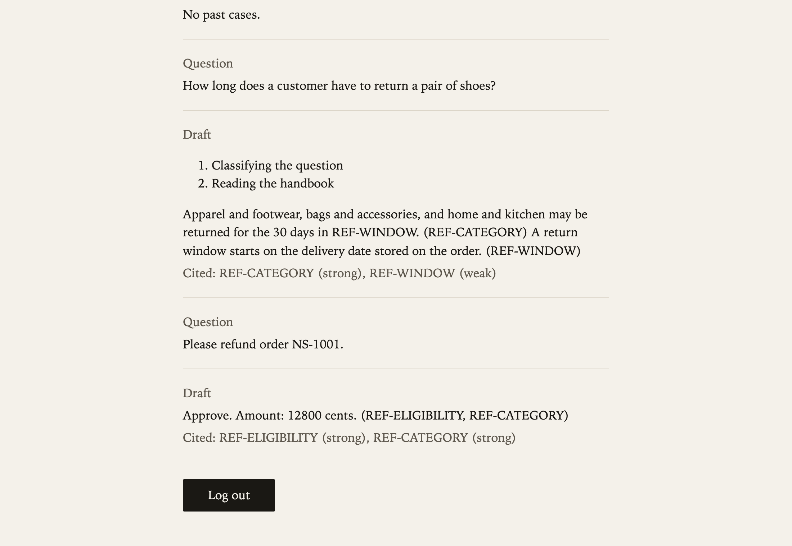
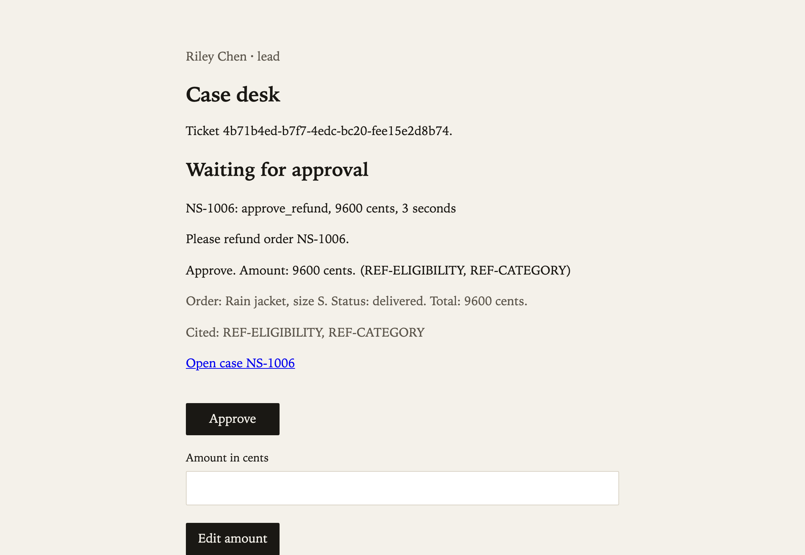
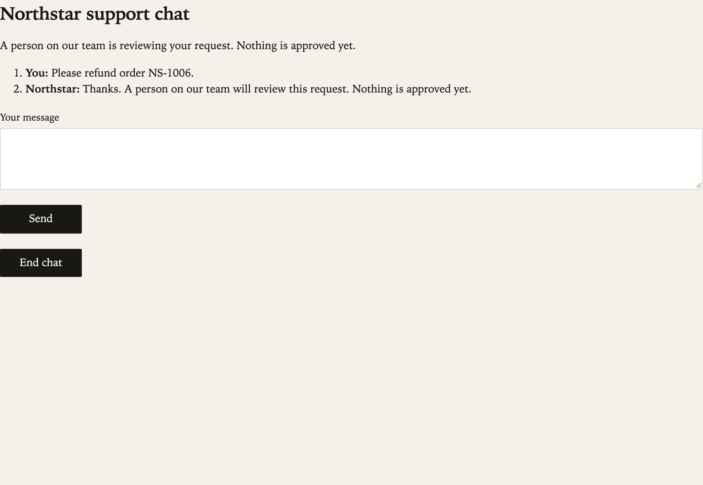
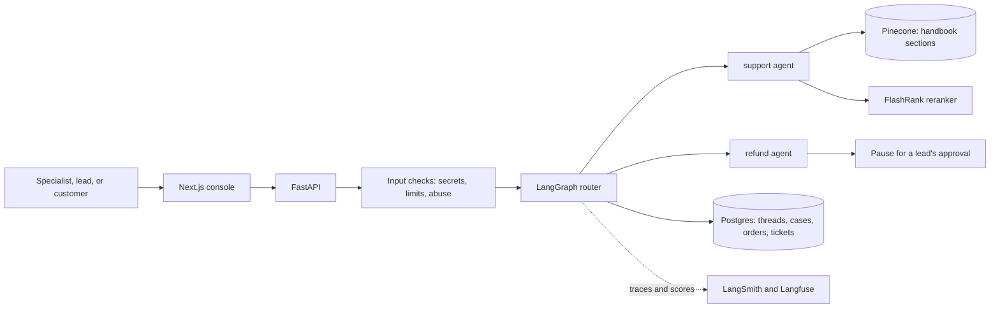
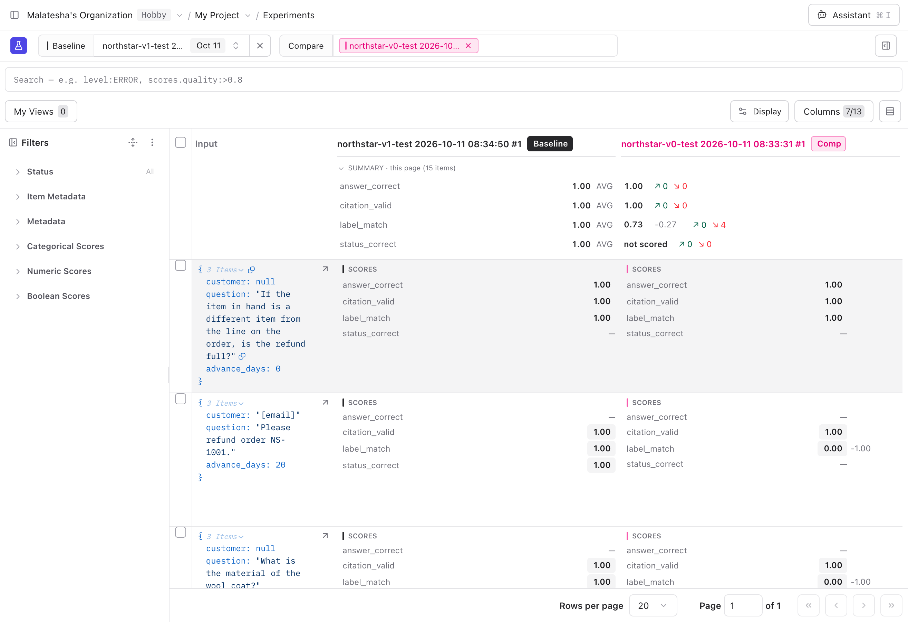
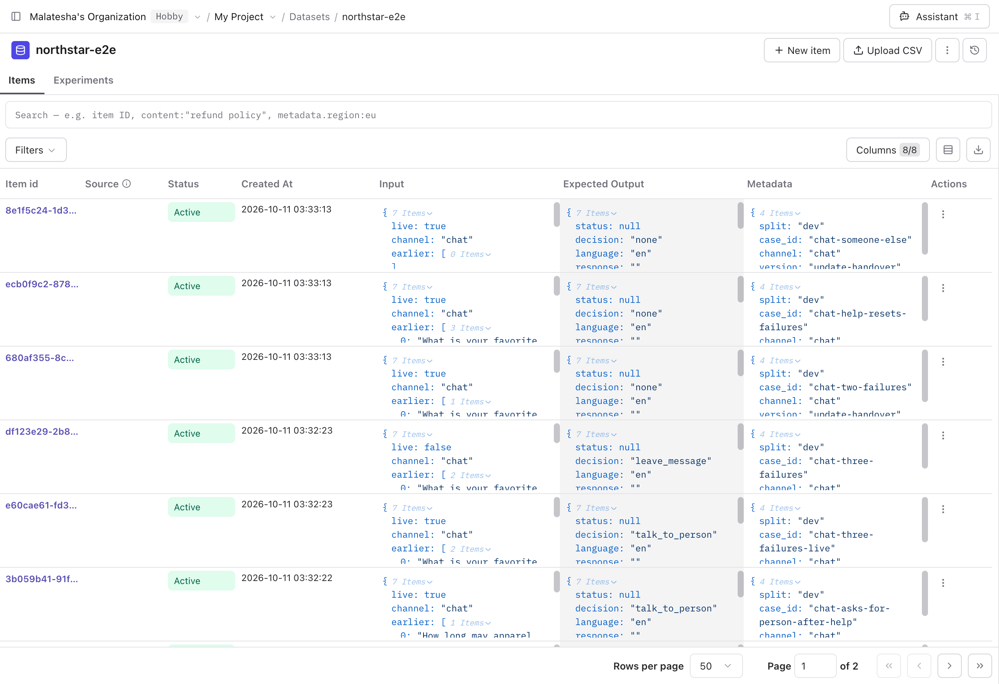
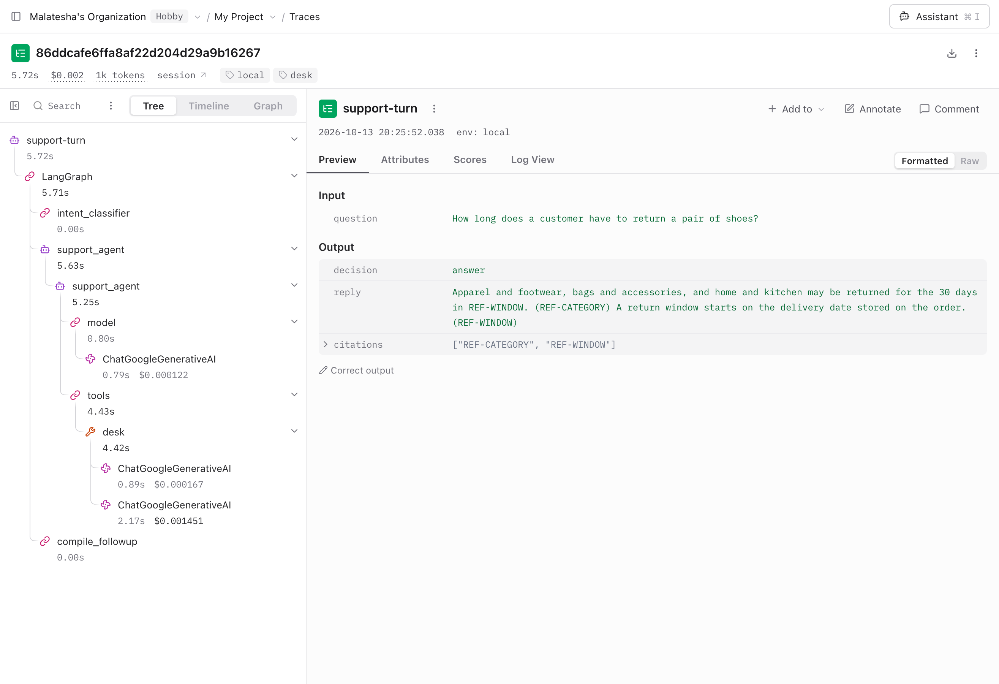

# Northstar Support Agent

A support agent for a fictional store, Northstar Goods, built so that a person can trust it. It answers policy questions from a written handbook and cites the section, or says it does not know. It looks up orders. Anything that moves money or changes an order is only a proposal: a lead approves it before a ticket exists.

Built by Malatesha with LangGraph, LangChain, FastAPI, Next.js, Postgres, and Pinecone. Evaluated with LangSmith and Langfuse.

## What it does

| Who | What they get |
| --- | --- |
| Support specialist | A desk: paste the customer's words, get a cited draft, a refusal with the rule, or a proposal that waits for a lead |
| Support lead | An approval queue with citations and an order summary, the option to edit an amount, an escalations inbox, and a list of questions the handbook could not answer |
| Customer | A chat that opens with an order id and the order's email, answers from the same handbook, and can hand over to a person |

The specialist's desk: a cited handbook answer, then a refund proposal that waits for a lead.



The lead's queue after one approval: the ticket, and the next proposal with its order summary and citations.



The customer's side of the same request: nothing is approved yet, and no amount is shown.



Actions behind the approval gate: refund, cancel, address change, exchange, warranty claim, and lost-package refund. Each has one handbook rule in code. Also built: damaged-item photos, Spanish replies, customer preferences across cases, and live chat with a specialist (off by default).

## How it works



- **Deterministic first.** Secrets, rate limits, order lookups, and every money rule are plain code. A model writes wording and picks a route; it never decides an amount.
- **Cite or abstain.** A handbook answer must cite a real section id. A bad citation becomes an abstain before it is saved.
- **Human approval.** A proposal pauses the graph thread in Postgres. The lead's decision resumes it. No ticket exists before that.
- **Masked traces.** Emails, phone numbers, and secrets are masked before anything is saved or sent to a tracing service.

The full design, one diagram per layer with its source in the LangChain docs, is in [`architecture.md`](architecture.md). The reasons behind each choice are in [`explanation.md`](explanation.md).

## Evaluation

The agent is measured the same way before every release.

| Piece | What it is | Where |
| --- | --- | --- |
| Golden dataset | 125 labeled end-to-end cases (41 of them from live turns) and 14 router cases, versioned by tag, split into dev and held-out test | [`evals/labeled.py`](evals/labeled.py) |
| Experiments | v0 (handbook answerer only), v1 (the live desk), and the router alone, on the same held-out cases | [`evals/experiments.py`](evals/experiments.py), [`evals/langfuse_experiments.py`](evals/langfuse_experiments.py) |
| Code checks | Decision matches the label, citations are real, ticket status is right, reply language and photo verdict are right, steps happen in order | [`evals/experiments.py`](evals/experiments.py), [`evals/trajectory.py`](evals/trajectory.py) |
| LLM judge | A different model from the agent, a majority of three, calibrated against human labels (5 of 5) | [`evals/judge.py`](evals/judge.py), [`results/judge_calibration.md`](results/judge_calibration.md) |
| Online checks | A safety rule on every turn; a groundedness judge on every abstain, escalation, human edit, and a 10% sample | [`packages/agent/northstar/online.py`](packages/agent/northstar/online.py) |
| Release bar | A gate before promotion; CI refuses a release whose results file is missing, stale, or failing | [`evals/release_bar.py`](evals/release_bar.py), [`results/release_bar.json`](results/release_bar.json) |

The release bar's gates: at least 80% of actions correct, no ticket without approval, no invalid or missing citation, every abstain case abstains, p95 latency under 10 s in English and 20 s in Spanish, and a token cap per turn.

Before and after, on 15 held-out cases run three times ([`results/v0_v1.md`](results/v0_v1.md)):

| Version | Cases passed | Misses |
| --- | --- | --- |
| v0, handbook answerer on every question | 11 of 15 | Answers where it should deny, escalate, abstain, or propose a refund |
| v1, the router and the desk | 15 of 15 | None |

The same comparison in Langfuse, with v1 as the baseline: the decision label drops to 0.73 on v0 while its wording and citations still score 1.00.



The golden dataset: each item has an input, an expected decision, and its split and version.



One turn as a trace: the router, the agent, the desk tool, and each model call with its time and cost.



Specialist edits feed the dataset: a corrected draft can be promoted into a new dataset version and is then part of every later run. The same cases, targets, and evaluators run in both LangSmith and Langfuse.

## What went wrong, and what it costs

[`EDGECASES.md`](EDGECASES.md) lists the failures found while building this, each with its root cause, its fix, and the test that now guards it. It also covers cost and speed. On the same 41 conversations with real models:

| Measure | Before | After |
| --- | --- | --- |
| Latency p50 / p95 | 2.54 / 7.97 s | 0.90 / 4.26 s |
| Model calls per turn | 2.25 | 1.51 |
| Cost per model turn, judge included | $0.00170 | $0.00078 |

The conversation checks behind those numbers are in [`results/`](results). Every change and the reason for it is in [`correction.md`](correction.md).

## Run it

You need Docker, Python with [uv](https://docs.astral.sh/uv/), and Node. Copy `.env.example` to `.env` and fill in the keys for Gemini, Pinecone, and OpenRouter. Tracing keys are optional.

```
make db
make api
make web
```

The API listens on `127.0.0.1:8000` and the console on `127.0.0.1:3000`. Postgres is on port 5433. Staff accounts are seeded when the API starts; their passwords are in `packages/agent/northstar/identity/seed.py`.

Check it:

```
make test                                                # 372 Python tests, no keys needed
cd apps/web && npx playwright test                       # 12 browser tests with accessibility checks, on a fresh database
uv run python -m evals.experiments release --no-upload   # the release bar, with real models
```

## Where things are

| Path | What |
| --- | --- |
| `packages/agent/northstar/` | The agent: graph, retrieval, action rules, guardrails, tracing |
| `apps/api/` | FastAPI routes and the tests |
| `apps/web/` | The Next.js console and the browser tests |
| `evals/` | Labeled cases, experiments, judges, the release bar |
| `data/policy/` | The handbook, the only source of company rules |
| `results/` | Measured results of experiments and conversation checks |
| [`prd.md`](prd.md), [`docs/spec.md`](docs/spec.md), [`AGENTS.md`](AGENTS.md) | Requirements, the spec, and the project contract |
| [`docs/handoff.md`](docs/handoff.md) | Current state, the demo script, and what is still open |

## Known limits

- Spanish replies are slower than English and have their own latency target.
- The reranker is a small CPU model. It scores some plainly worded questions low, so those abstain where a stronger model would answer.
- Google sign-in is built but off until OAuth values are set.
- Nothing is deployed publicly. The app runs locally with the commands above.
